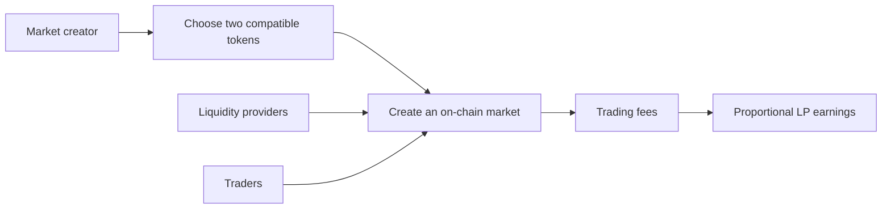

# Liquern

A multi-chain market platform on Ethereum Mainnet, Robinhood Chain, and Base.

Create a market between compatible tokens, provide liquidity, trade, and earn a proportional share of trading fees. Liquern connects tokenized stocks, ETFs, cryptocurrencies, stablecoins, and ecosystem tokens through independent on-chain markets.

[Website](https://liquern.com) · [X](https://x.com/liquern_) · [Watch the banner](assets/liquern-profile-banner.mp4)

## Create markets. Supply liquidity. Earn fees.

Anyone can create an A/B market on a supported network. If they also supply liquidity, trades in A/B generate fees for their position according to their share of the pool. Creating a pair without providing liquidity does not earn fees.

Each market is an independent AMM pool. Both assets belong to the selected network. Switching networks does not bridge assets.

## Live networks

| Network | Chain ID |
|---|---:|
| Ethereum Mainnet | 1 |
| Robinhood Chain | 4663 |
| Base | 8453 |

## Explore the code

| Repository | What you will find |
|---|---|
| [liquern-app](https://github.com/liquern/liquern-app) | The web application, wallet flows, token catalogues, markets, and liquidity views |
| [liquern-contracts](https://github.com/liquern/liquern-contracts) | The Solidity market, liquidity, router, registry, and treasury contracts |
| [liquern-sdk](https://github.com/liquern/liquern-sdk) | A typed client, React Query hooks, and public OpenAPI schema |
| [liquern-docs](https://github.com/liquern/liquern-docs) | Detailed product and developer guides |

## Build with Liquern

The public repositories separate the application, contracts, client SDK, and documentation so each component can be reviewed and developed independently.

The software is available under the MIT license. Smart contracts are unaudited. Token compatibility, issuer restrictions, liquidity, and market risks still require independent review.
